<div align="center">


# Travel Agency Full CRM

**A website that brings customers in on WhatsApp, and a dashboard that turns every conversation into a sale.**

Arabic · French · English  ·  Phone and desktop

</div>

<p align="center">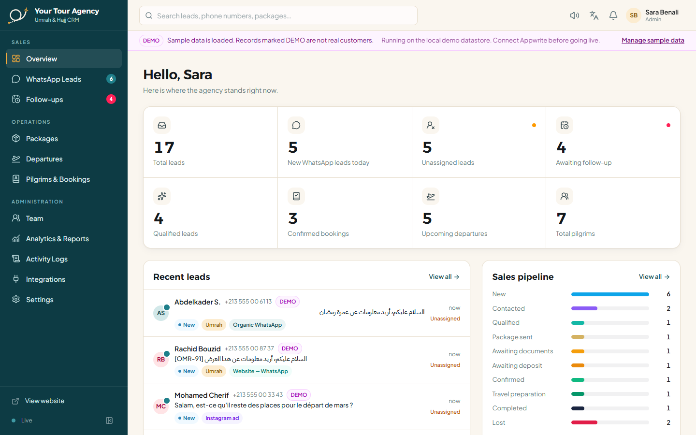</p>

---

## What you get

| | |
|---|---|
| **Public website** | Shows the agency's services and trips (Umrah, Hajj, Turkey, tours in Algeria, flights & visas). Every button opens WhatsApp or a call-back form. |
| **Admin dashboard** | Every WhatsApp conversation appears automatically as a lead. The team follows each customer from the first message to the booking, the payment and the trip. |

---

## Contents

1. [Start in 2 minutes](#start-in-2-minutes)
2. [First setup (owner)](#first-setup-owner)
3. [Sell in 4 clicks](#sell-in-4-clicks)
4. [The admin dashboard, screen by screen](#the-admin-dashboard-screen-by-screen)
5. [A day with the CRM](#a-day-with-the-crm)
6. [Who can do what](#who-can-do-what)
7. [The public website](#the-public-website)
8. [Put it online with Vercel](#put-it-online-with-vercel)
9. [For developers](#for-developers)

---

## Start in 2 minutes

You need **Node.js 20.12 or newer**.

```bash
npm install
npm run dev
```

- Website: <http://localhost:5173>
- Dashboard: <http://localhost:5173/admin>

The first time you open the dashboard, it asks you to create the **administrator account**.

> **Want to see it full of data?** Go to **Integrations → Demo & testing → Load sample data**. Every sample record has a purple **DEMO** badge and can be removed in one click.

---

## First setup (owner)

Do these once, in this order:

| Step | Where | What to enter |
|:-:|---|---|
| 1 | **Settings → Agency profile** | Agency name (French + Arabic), phone, **WhatsApp number** (digits only, e.g. `213776331900`), Instagram, Facebook, address, opening hours, licence number. The website's WhatsApp buttons appear as soon as the number is saved. Empty fields are simply hidden on the website. |
| 2 | **Team → Add employee** | One account per employee with a temporary password and a role (Admin, Manager or Agent). |
| 3 | **Packages → New package** | Each trip: name, type, hotels, distance to the Haram, airline, price, a **cover photo** (drag it from your computer or pick it from your phone), status *Active* to publish it. |
| 4 | **Departures → New departure** | The dated groups of each package, with capacity. The website shows the seats left automatically. |
| 5 | **Settings → Lead automation** | Assign new leads automatically to the team in turn, or let a manager assign them. |
| 6 | **Integrations** | Connect the agency's WhatsApp number (see [Put it online with Vercel](#put-it-online-with-vercel)). |

---

## Sell in 4 clicks

You never need to know the stage names. Open a customer: a **progress bar** shows where they are (*New → Talking → Offer chosen → Booked → Travelled*), and a green **Next step** box tells you what to do now, with one button.

| | What you see | What you press |
|:-:|---|---|
| **1** | 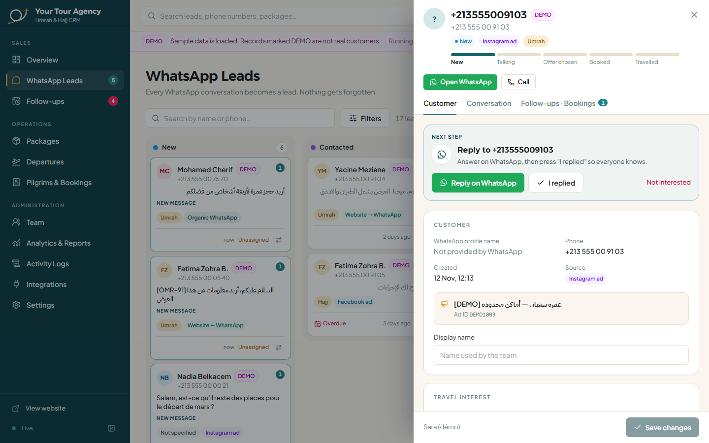 | A customer just wrote. Press **Reply on WhatsApp**, answer them, then press **I replied**. |
| **2** | 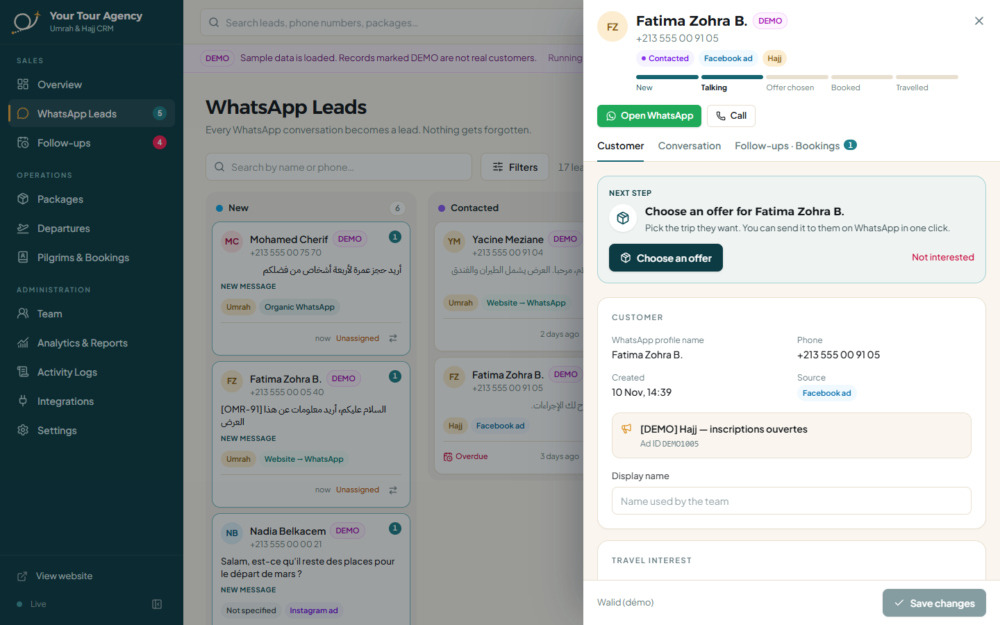 | Press **Choose an offer**. |
| **3** | 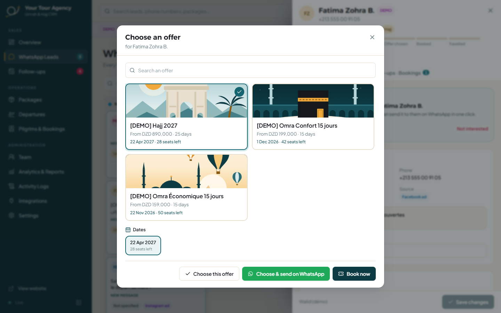 | Tap the trip they want (with its photo, price, dates and seats left). Then either **Choose & send on WhatsApp** (the offer and its link are written for you), or **Book now** if they already said yes. |
| **4** | 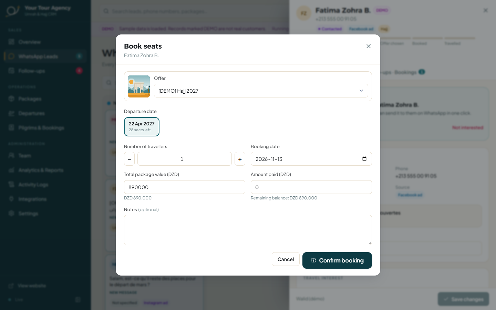 | Tap the date, set the number of travellers with **−/+**, type what they paid. The price is calculated. Press **Confirm booking**. The seats are taken, one traveller file is created per person, and the customer is marked as booked. |
| ✓ | 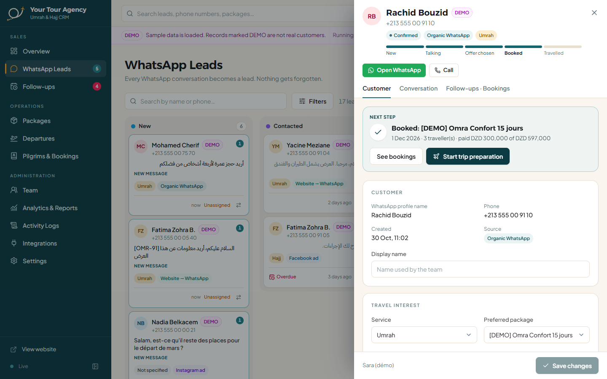 | The card now shows the booking and what is still to pay. Later: **Start trip preparation**, then **Trip completed**. |

**Not interested?** Every step has a **Not interested** link: tap a reason (too expensive, booked elsewhere, dates don't fit, no answer, maybe later). It feeds the *Lost leads* report. **Talk again** brings them back.

**Starting from the offer instead?** On the **Packages** page, every offer has a **Book a customer** button: search the customer by name or phone, and the same booking window opens.

<p align="center">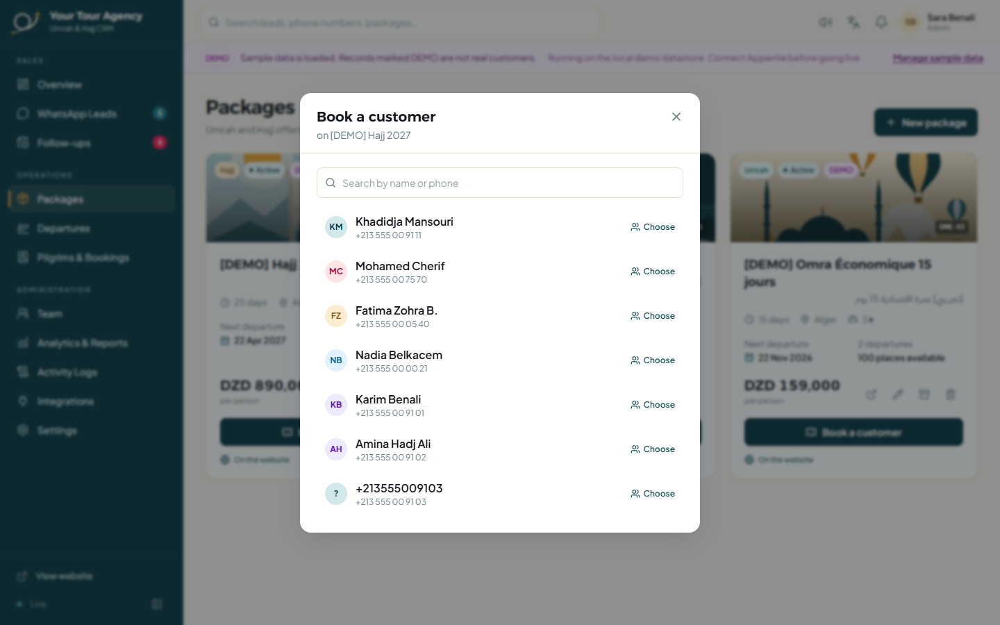</p>

---

## The admin dashboard, screen by screen

The menu on the left has three groups: **Sales**, **Operations** and **Administration**. The top bar has the search box (leads, phone numbers, packages), the language switch, the notification bell and your profile.

### Sign in

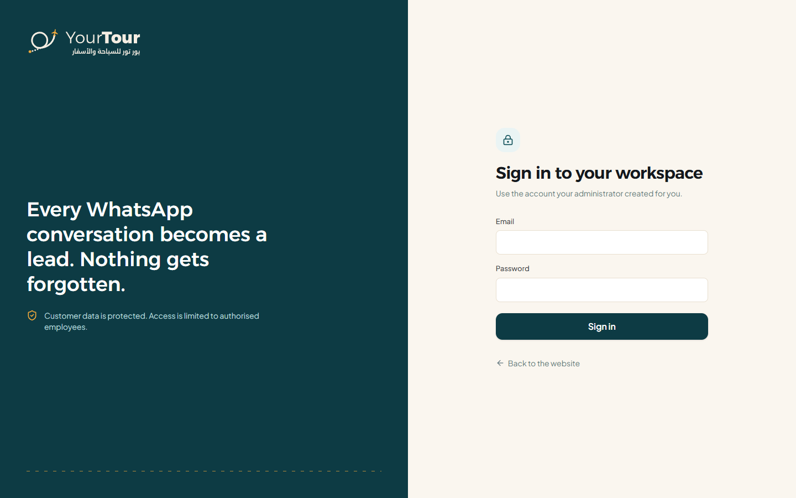

Each employee signs in with their own email and password. After 8 failed attempts in 5 minutes, sign-in is paused for a few minutes. A deactivated employee is signed out immediately.

---

### 1. Overview


The home page of the dashboard. It shows where the agency stands **right now**:

- **8 counters**: total leads · new WhatsApp leads today · unassigned leads · awaiting follow-up · qualified leads · confirmed bookings · upcoming departures · total pilgrims.
- **Recent leads**: the latest conversations, one click opens the customer.
- **Sales pipeline**: how many leads are at each stage.
- **Upcoming departures**: seats booked out of the capacity, for each group.
- **Team performance**: leads received, contacted and converted per employee.
- **Recent activity**: the last actions in the agency.

Agents see the same page limited to **their own** leads and bookings.

---

### 2. WhatsApp Leads

The heart of the CRM. **Every WhatsApp conversation becomes a lead automatically**: name, phone number, first message and where the customer came from (Facebook ad, Instagram ad, website, organic…) are filled in without typing anything.

#### Pipeline view

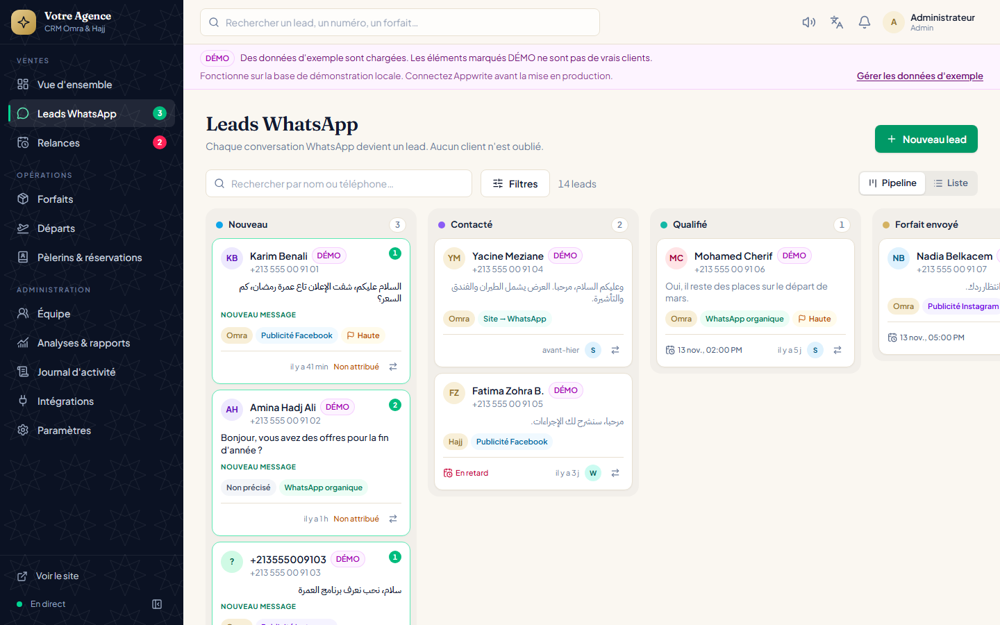

One column per stage. **Drag a card** to another column to change its stage. A green number on a card means unread messages.

| Stage | Meaning |
|---|---|
| **New** | The customer just wrote. Nobody has answered yet. |
| **Contacted** | The team answered. |
| **Qualified** | We know what they want (service, dates, number of people, budget). |
| **Package sent** | An offer was sent. |
| **Awaiting documents** | Waiting for passport, photos, papers. |
| **Awaiting deposit** | Waiting for the first payment. |
| **Confirmed** | Sale done. A booking can be created. |
| **Travel preparation** | Visa, tickets, hotel, final details. |
| **Completed** | The trip is over. |
| **Lost** | Did not buy. A reason is required, it feeds the reports. |

#### List view

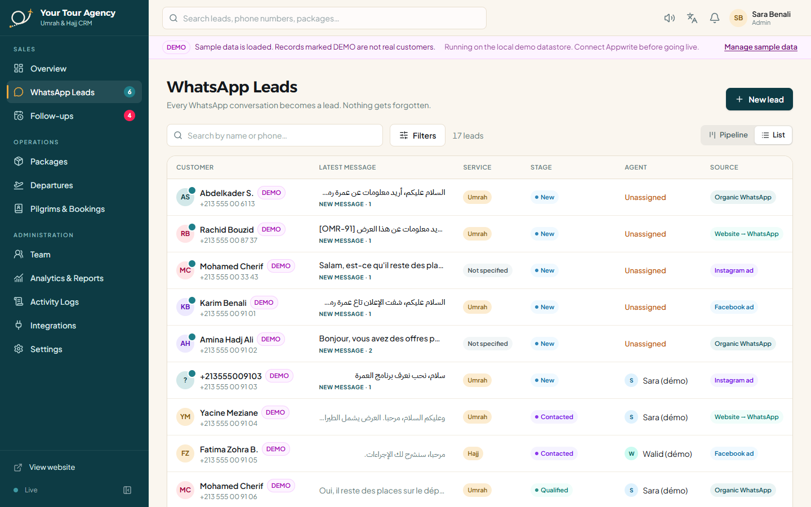

The same leads as a table, easier to scan and sort. **Filters**: stage, service (Umrah / Hajj), assigned employee, source, priority, creation date. The search box finds a name or a phone number. **New lead** adds a customer who called or walked in.

#### The customer card

Click any lead to open its card on the side. At the top: the progress bar and the **Next step** box (see [Sell in 4 clicks](#sell-in-4-clicks)). Below, three tabs:

<table>
<tr>
<td width="33%">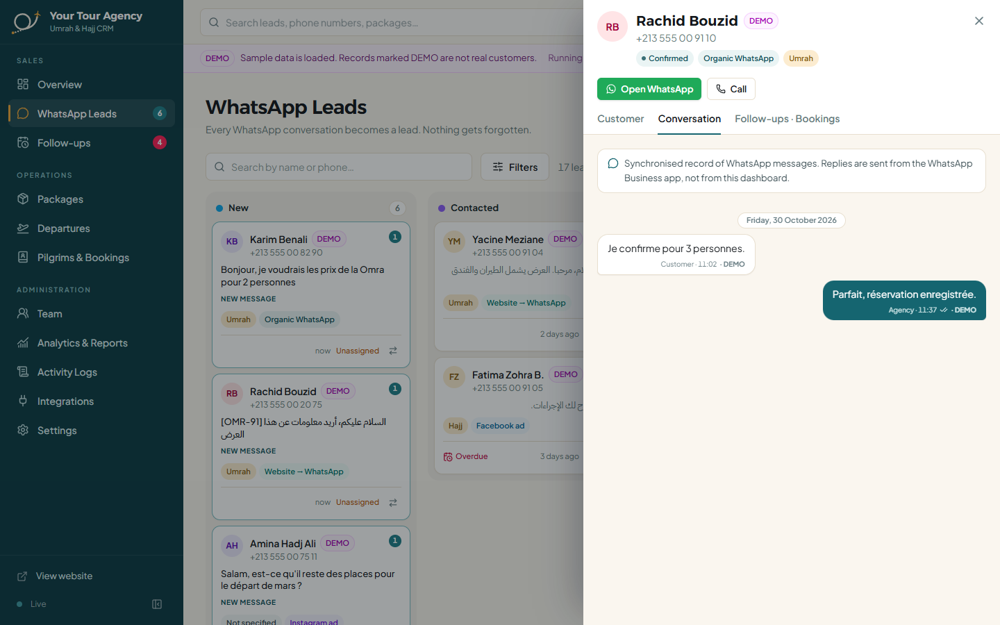</td>
<td width="33%">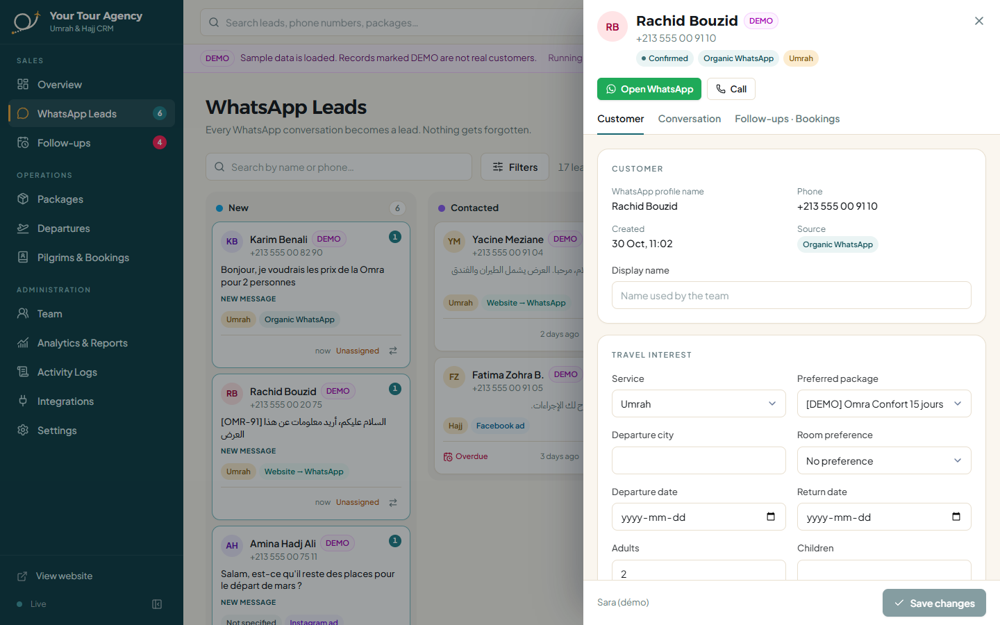</td>
<td width="33%">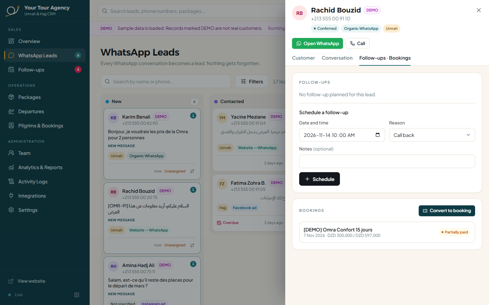</td>
</tr>
<tr>
<td><b>Conversation</b><br/>Every WhatsApp message, customer on the left, agency on the right. Replies are sent from the WhatsApp Business app on the phone; they appear here automatically.</td>
<td><b>Customer</b><br/>Profile, source and ad, travel interest (service, package, departure city and dates, adults, children, room, budget), stage, priority, assigned employee, notes, tags.</td>
<td><b>Follow-ups · Bookings</b><br/>Plan the next call (call back, send offer, documents, deposit) and turn the lead into a booking in one click.</td>
</tr>
</table>

The **Open WhatsApp** and **Call** buttons at the top open the conversation on the phone or dial the customer directly.

---

### 3. Follow-ups

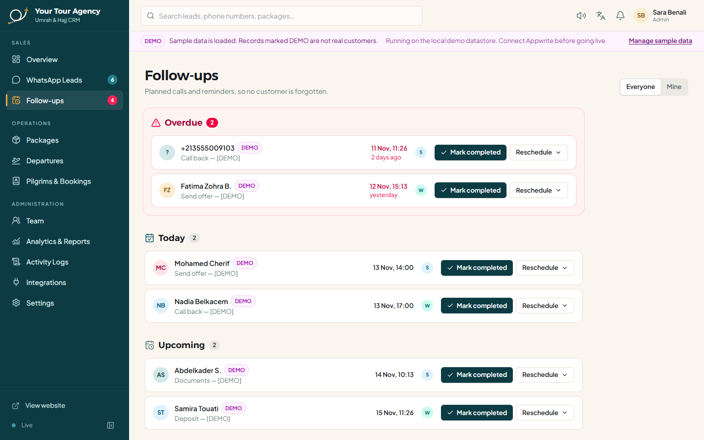

Every planned call or reminder, in four groups: **Overdue** (in red), **Today**, **Upcoming**, **Completed**. One click marks it done, one click reschedules it. The red number next to *Follow-ups* in the menu counts what is overdue, so nothing is forgotten.

---

### 4. Packages

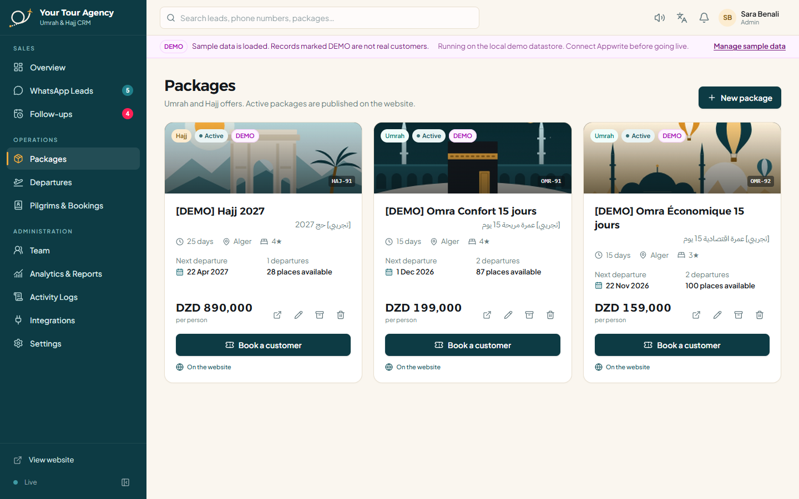

The trips the agency sells. For each package: name in French and Arabic, Umrah or Hajj, description, duration, departure city, airline and direct flight or not, hotel in Makkah and Madinah, hotel area, **distance and walking time to the Haram**, transport, room options (single, double, triple, quad), price in DZD and a reference code (`OMR-01`, `HAJ-01`…).

**Cover photo:** drag a photo onto the box, or click it to pick one from the computer or the phone gallery. It is resized automatically so it loads fast on the website. You can still paste a link instead.

<p align="center">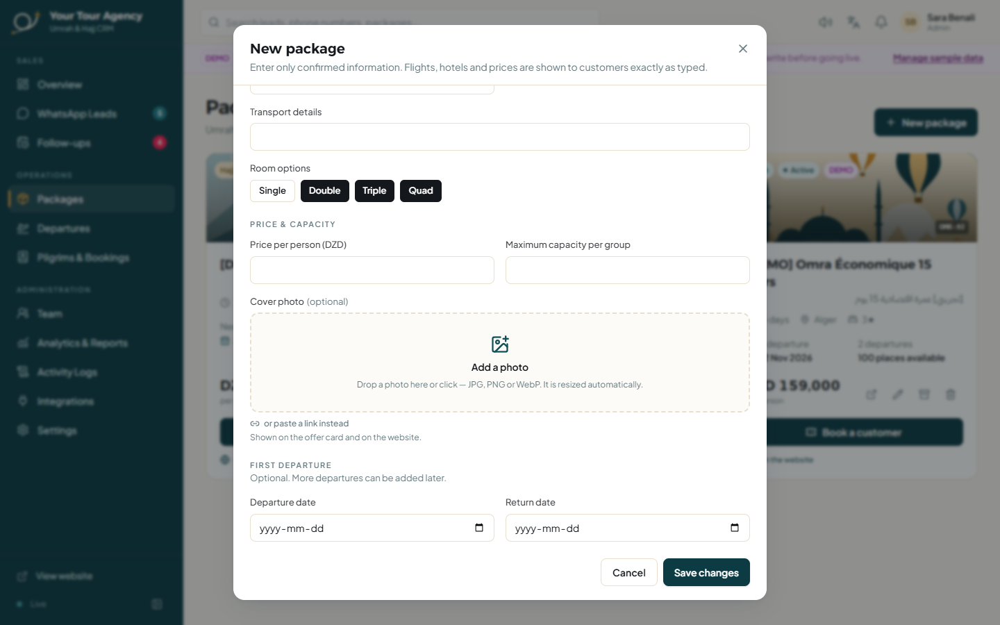</p>

Status decides what the public sees: **Draft** (hidden), **Active** (on the website), **Sold out**, **Archived**. The **Book a customer** button on each card books someone directly on that offer.

---

### 5. Departures

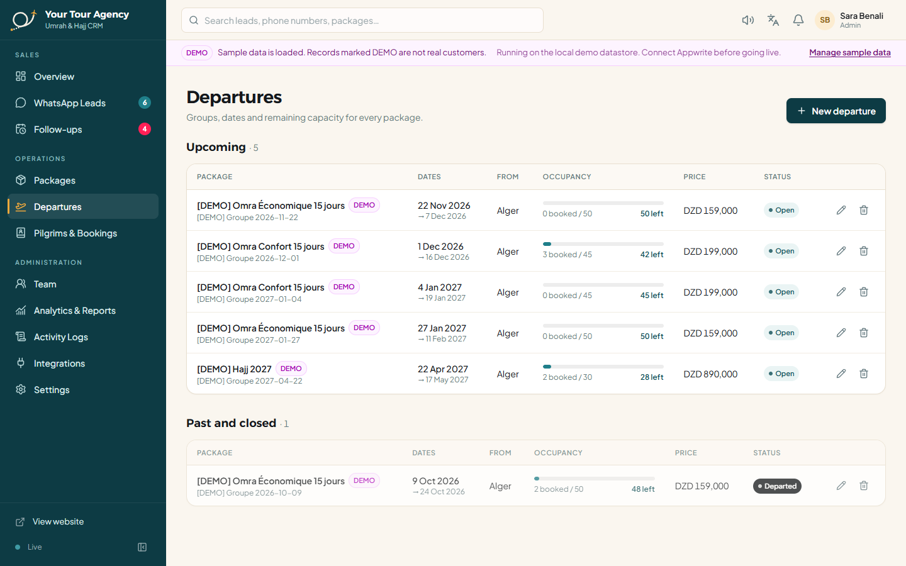

The dated groups of each package: departure and return dates, city, **capacity**, a price that can override the package price, flight details and status (Open, Closed, Departed, Cancelled). The occupancy bar shows how full each group is. **Seats left are always calculated from the bookings**, never typed by hand.

---

### 6. Pilgrims & Bookings

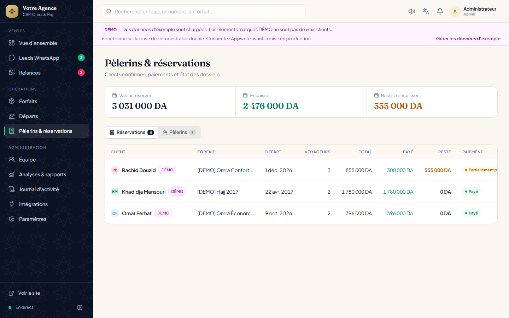

**Bookings**: one line per sale with the customer, package, departure, number of travellers, total, amount paid, what is still due, and the payment status (Unpaid, Partially paid, Paid, Refunded, Cancelled).

**Pilgrims**: one line per traveller with a **document checklist** (passport received, photographs received, required documents received, final travel preparation; editable in Settings) and the **visa status** (Not started, In progress, Submitted, Approved, Rejected). No passport number or scan is stored.

---

### 7. Team

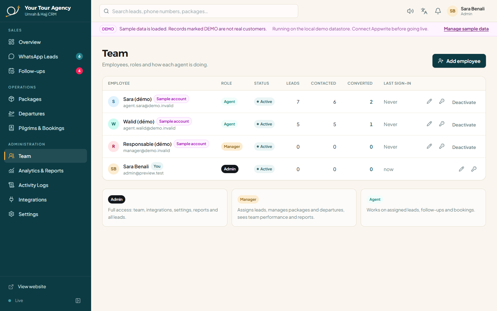

Add employees, choose their role, reset a password, deactivate an account (the person is signed out at once). The table shows, for each employee, how many leads they received, contacted and converted, and their last sign-in.

---

### 8. Analytics & Reports

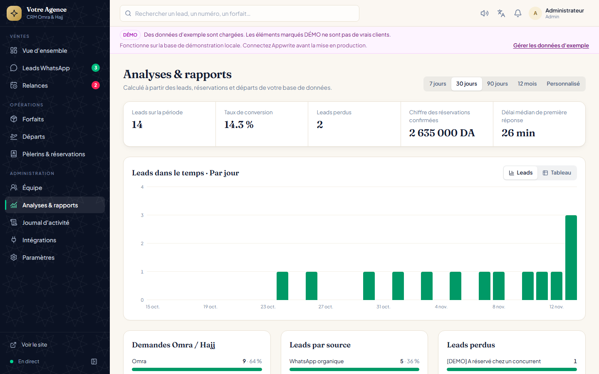

Choose a period (7 days, 30 days, 90 days, 12 months or custom dates) and see:

- Leads in the period · **conversion rate** · lost leads · **revenue** from confirmed bookings · **median first response time**
- Leads over time (per day, week or month)
- Umrah vs Hajj inquiries · leads by source (which ads work)
- Why leads were lost · bookings per employee
- Most successful packages · occupancy of upcoming groups

Every number is calculated from the real records, nothing is estimated.

---

### 9. Activity Logs

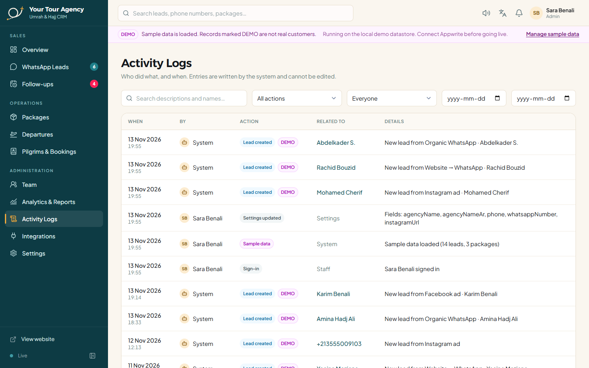

A permanent history of everything that happened: lead created, message received, lead assigned, stage changed, booking created, payment updated, follow-up done, package changed, employee added, sign-in… with who did it and when. **Entries can never be edited or deleted.** Search and filter by action, person or date.

---

### 10. Integrations

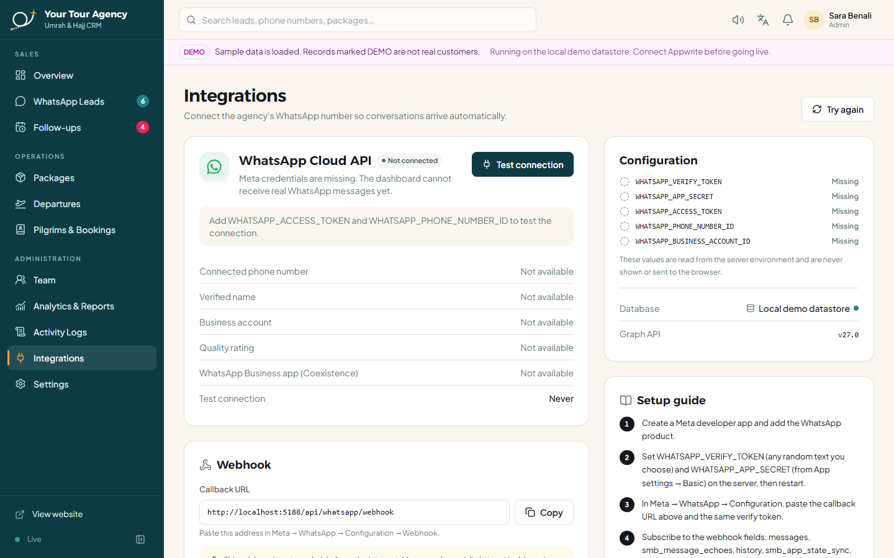

Connects the agency's WhatsApp number through Meta's WhatsApp Cloud API. The page says honestly whether it is **Not connected**, **Configured**, **Connected** or in **Error**, lists which credentials are missing, gives the webhook address to paste in Meta, and has a **Test connection** button and a step-by-step guide.

**Demo & testing** (administrators only): load or remove sample data, and simulate incoming WhatsApp messages (new customer, Facebook ad, Instagram ad, website button…) to train the team.

---

### 11. Settings

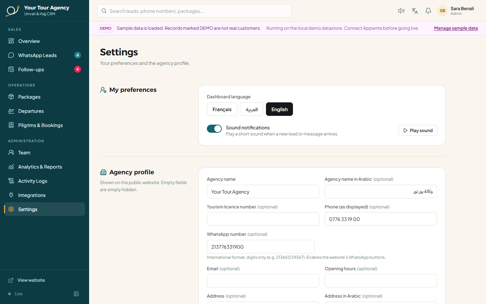

- **My preferences**: dashboard language (Français, العربية, English) and notification sound.
- **Agency profile**: everything shown on the public website.
- **Lead automation**: assign new leads automatically in turn between active agents, and move a *New* lead to *Contacted* automatically when the agency replies from the WhatsApp Business app.
- **Pilgrim checklist**: the documents to collect for each traveller.

---

### Live notifications

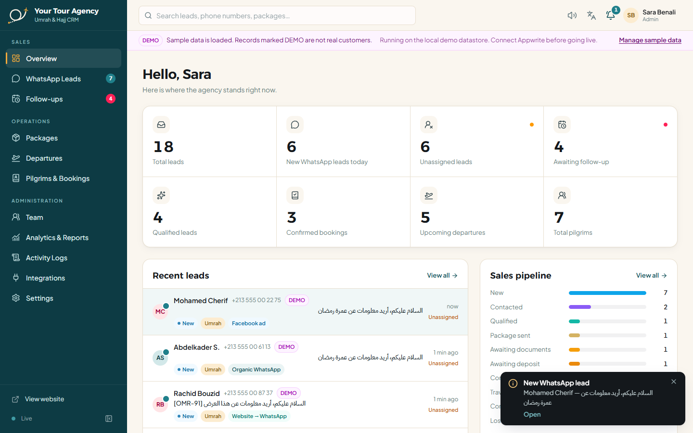

When a customer writes, the dashboard updates **instantly** on every open screen: a notification appears with a short sound, the lead jumps to the top, the counters change. No need to refresh the page.

### Arabic and phone

<table>
<tr>
<td width="62%">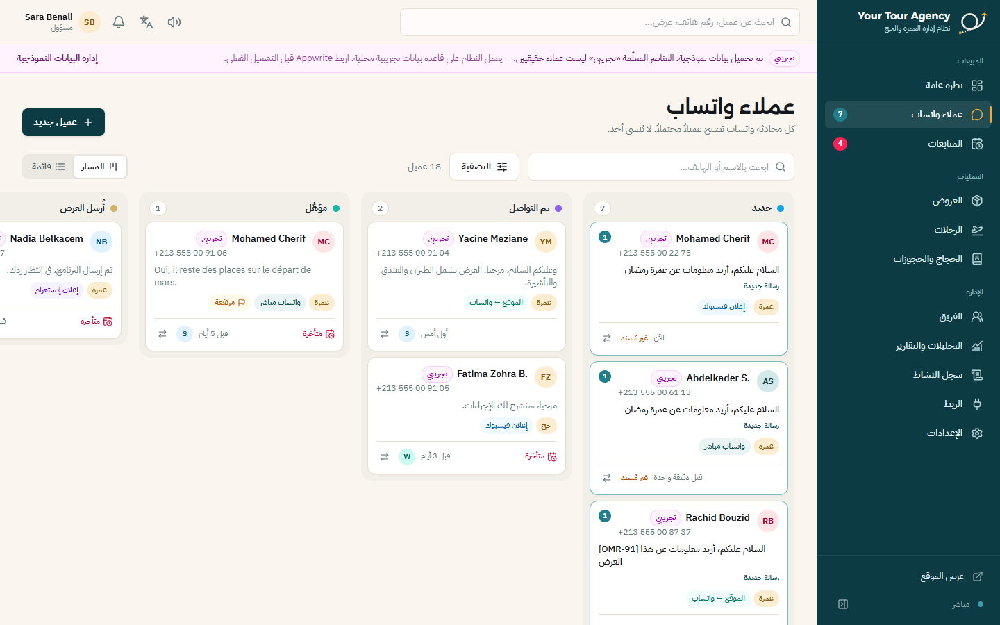</td>
<td width="38%">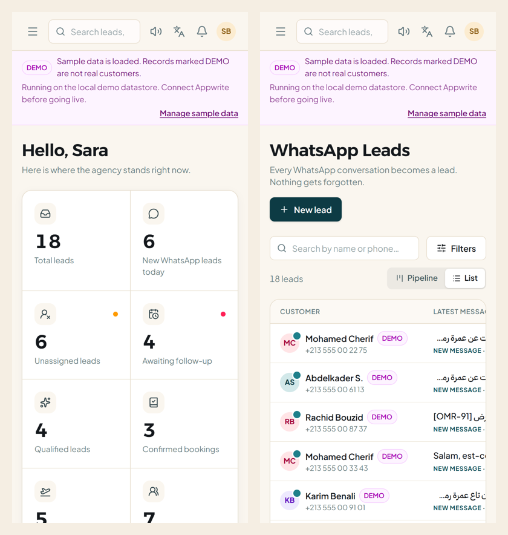</td>
</tr>
<tr>
<td>The whole dashboard works in Arabic, right to left.</td>
<td>And on a phone, for staff on the move.</td>
</tr>
</table>

---

## A day with the CRM

1. **Morning**: open **Overview**. Check *Unassigned leads* and *Awaiting follow-up*.
2. Open **Follow-ups**. Call everyone in **Overdue** and **Today**, mark each one done or reschedule it.
3. Open **WhatsApp Leads** and click each card in the **New** column. Follow the green **Next step** box: reply, choose an offer, book.
4. Fill the **Customer** tab when you learn something: dates, number of people, budget, notes.
5. After sending an offer, **schedule a follow-up** (*Follow-ups · Bookings* tab) so you call back.
6. In **Pilgrims & Bookings**, record payments and tick the documents as they arrive.
7. **End of week**: the manager opens **Analytics** to see which ads bring customers and how fast the team answers.

---

## Who can do what

| | Admin | Manager | Agent |
|---|:-:|:-:|:-:|
| See all leads and bookings | ✓ | ✓ | only their own |
| Add a lead, chat record, follow-ups | ✓ | ✓ | ✓ |
| Assign leads to employees | ✓ | ✓ | – |
| Create and edit packages and departures | ✓ | ✓ | view only |
| Analytics, team results, full activity log | ✓ | ✓ | – |
| Delete a lead | ✓ | – | – |
| Employees, integrations, settings, demo tools | ✓ | – | – |

These rules are checked by the server, not only hidden in the screen: an agent can never receive another person's customers.

---

## The public website

<p align="center">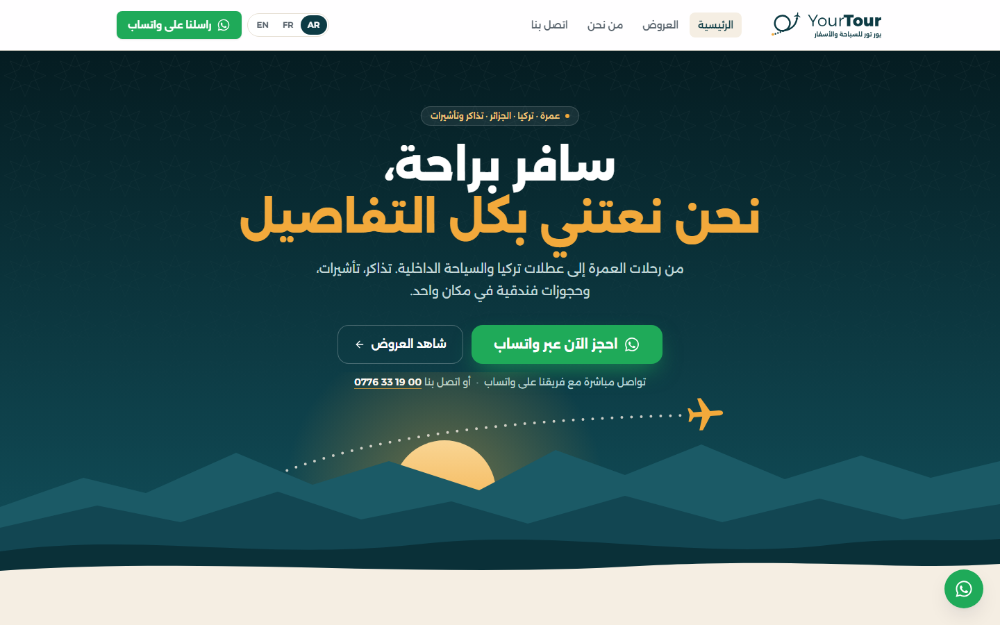</p>

<table>
<tr>
<td width="65%">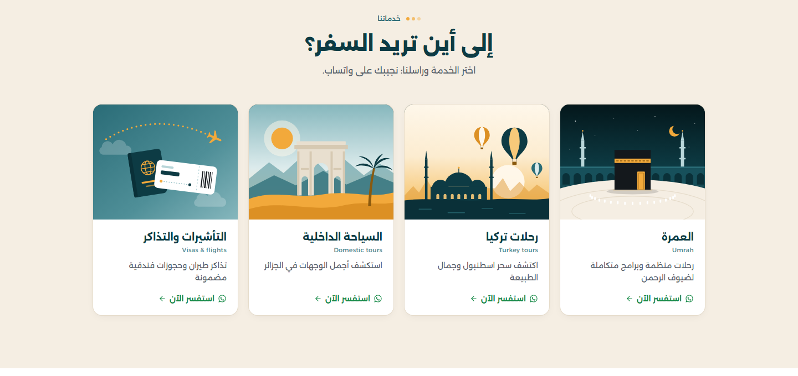</td>
<td width="35%">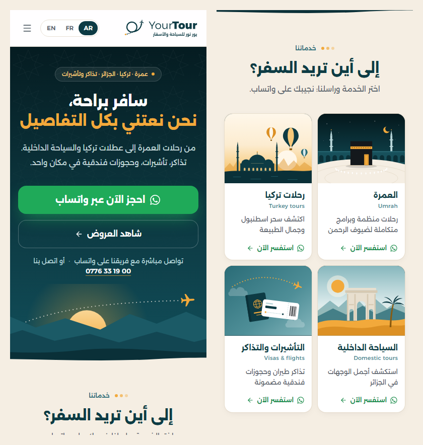</td>
</tr>
</table>

- **Home**: big WhatsApp button, the four services (Umrah, Turkey, Algeria, flights & visas), the published packages, why choose us, how it works and a call-back form.
- **Packages** and **package page**: dates, hotels, distance to the Haram, flight, price, and the **real seats left** for each departure.
- **About, Contact, Privacy**.
- **Three languages** (`/ar`, `/fr`, `/en`), designed for phones first because most visitors come from Instagram.

**How a website visitor becomes a lead:**

- They tap a WhatsApp button → WhatsApp opens with a message already written, starting with a code like `[OMR-01]`. When they send it, the CRM creates the lead **and links it to that package**.
- Or they fill the call-back form → the lead appears in the CRM with source *Website form*.

<details>
<summary>More website screenshots</summary>

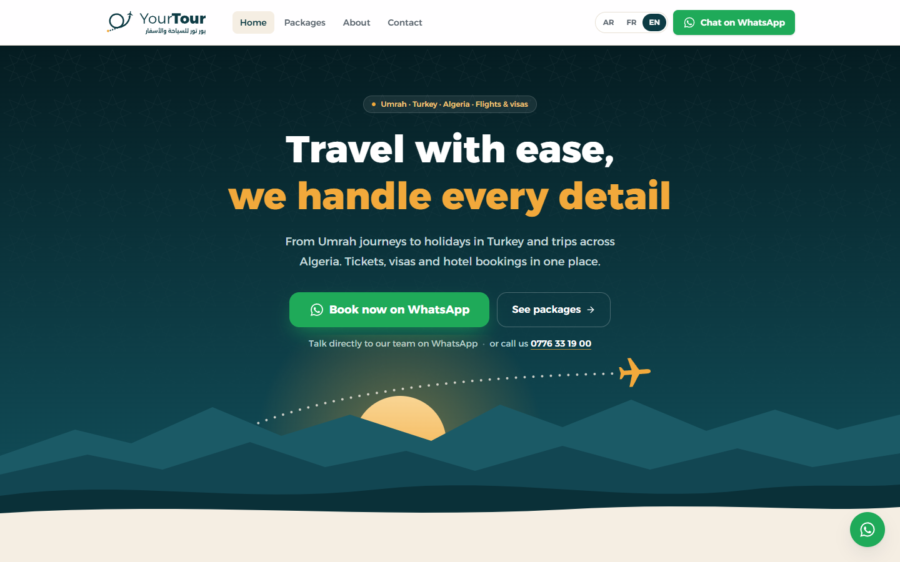
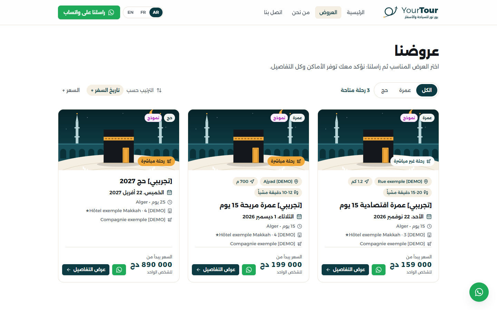
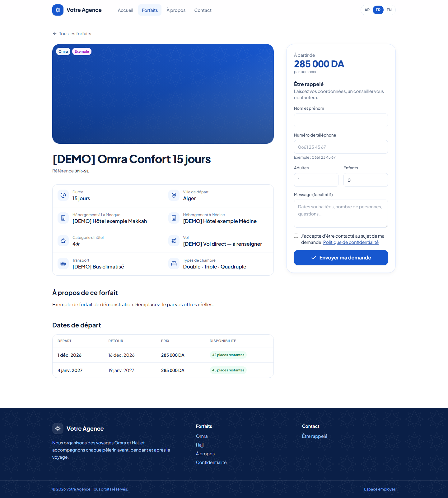
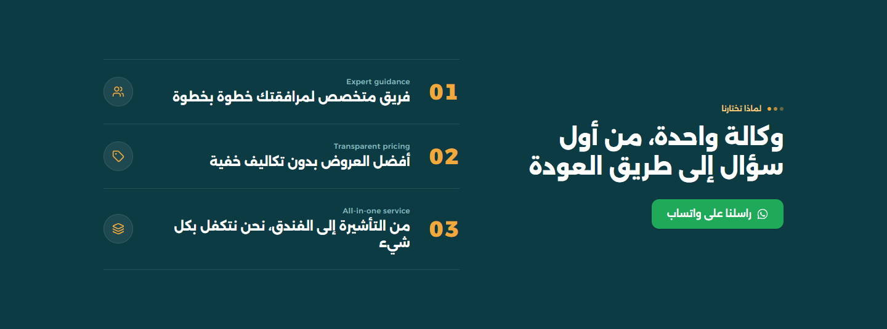
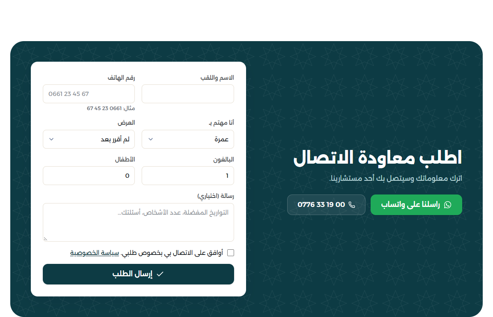
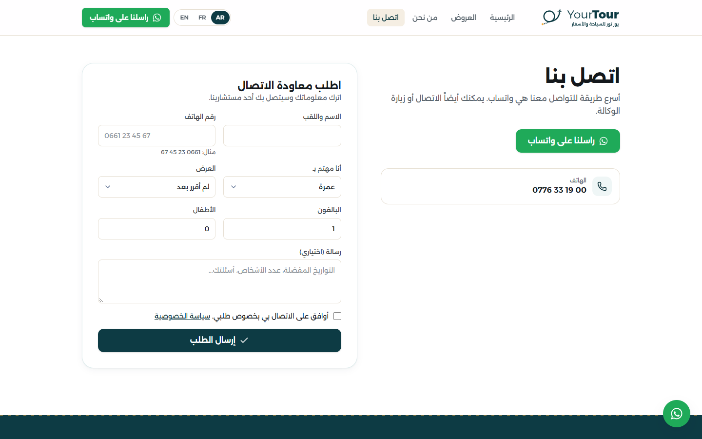

</details>

---

## Put it online with Vercel

Everything runs on Vercel: the website, the dashboard, the database (**Vercel Redis**) and the photos (**Vercel Blob**). No server to manage.

**1. Import the project**
On [vercel.com](https://vercel.com) → **Add New… → Project** → pick this GitHub repository → **Deploy**. Vercel detects React Router by itself. The first deploy works but has no database yet.

**2. Add the database**
In the project: **Storage → Create → Redis** (Upstash, free plan to start) → **Connect to project**. Vercel adds the connection setting (`REDIS_URL` or `KV_URL`) by itself.

**3. Add photo storage (recommended)**
**Storage → Create → Blob** → **Connect to project**. Vercel adds `BLOB_READ_WRITE_TOKEN`. Without it, photos are kept in Redis instead, which also works but uses more of the Redis allowance.

**4. Add 3 settings**
**Settings → Environment Variables**:

| Name | Value |
|---|---|
| `SESSION_SECRET` | A long random text (at least 32 characters). It protects sign-ins. |
| `ADMIN_EMAIL` | The owner's email. |
| `ADMIN_PASSWORD` | The owner's first password (at least 10 characters, change it after). |

> Set `ADMIN_EMAIL` and `ADMIN_PASSWORD` **before** sharing the link: they create the administrator account on first start, so nobody else can claim it.

**5. Redeploy**
**Deployments → ⋯ → Redeploy**. Open `https://your-project.vercel.app/admin`, sign in, then follow [First setup](#first-setup-owner). Check **Integrations → Database**: it should say *Redis (Vercel)* with a green test.

**6. WhatsApp (when ready)**
Add the `WHATSAPP_*` variables and follow [docs/META_SETUP.md](docs/META_SETUP.md). The webhook address is `https://your-domain/api/whatsapp/webhook`.

**Good to know on Vercel**
- New messages appear on open dashboards within **about 4 seconds** (the dashboard checks for changes only while the tab is visible).
- Two messages arriving at the same moment on two Vercel servers still create **one** customer: Redis locks and unique keys prevent duplicates.
- Free plans have monthly limits (Redis requests, Blob storage, function calls). A small agency usually stays inside them; Vercel's **Usage** page shows where you are.
- Redis keeps your data, but take regular exports of bookings and payments as a backup.

**Other hosts:** any Node server works too (`npm run build && npm run start`, or the included `Dockerfile`, e.g. on Railway or Render). There, live updates are instant and the database can be Redis, [Appwrite](docs/DATABASE.md), or the local file for a demo.

**Staff guides (PDF):** [full user guide](docs/YourTour-User-Guide.pdf) · [beginner guide](docs/YourTour-Beginner-Guide.pdf)

---

## For developers

<details>
<summary><b>Tech stack</b></summary>

React 19 · React Router 7 (framework mode, server rendering) · Vite · Tailwind CSS 4 · TypeScript (strict) · Redis / Appwrite · Vercel Blob · zod · lucide icons · Syncfusion charts (optional) · Vitest.

**Storage is chosen automatically:** Appwrite if `APPWRITE_*` is set, else Redis if `REDIS_URL` (or `KV_URL`) is set, else a local JSON file (`.data/db.json`) so everything works offline. Photos go to Vercel Blob if `BLOB_READ_WRITE_TOKEN` is set, else Redis, else `.data/uploads`.
</details>

<details>
<summary><b>Commands</b></summary>

| Command | Purpose |
|---|---|
| `npm run dev` | Development server on port 5173 |
| `npm run build` / `npm run start` | Production build / server |
| `npm run typecheck` | TypeScript check |
| `npm test` | Unit tests |
| `npm run test:acceptance` | 114 end-to-end checks on an isolated copy of the app |
| `REDIS_URL=redis://127.0.0.1:6379 REDIS_PREFIX=test npm run test:acceptance` | The same checks on Redis |
| `npm run test:appwrite` | The same checks against Appwrite (temporary database) |
| `npm run appwrite:start` / `appwrite:stop` | Local self-hosted Appwrite in Docker |
| `npm run dev:appwrite` | Development server on the local Appwrite |
| `npm run simulate -- --url <app> --name "Test" --text "Salam"` | Send one signed test WhatsApp event |
| `npm run guide:pdf` | Rebuild the staff user guide |
</details>

<details>
<summary><b>How it works</b></summary>

```
Website pages ────────────────┐
Dashboard ── /api/rpc/* ──────┤
Live feed ◄─ /api/events (SSE)┤──  React Router server  ──  Redis · Appwrite · local JSON file
        or ◄─ /api/changes    ┤
Photos ── /api/upload ────────┤──  Vercel Blob · Redis · disk
Meta ── /api/whatsapp/webhook ┘
```

- The browser never talks to the database: the server checks the session, the role and every input, and writes the activity log.
- WhatsApp webhooks are signature-checked, stored, and processed so that the same message or customer can never be created twice. They never overwrite what an employee typed.
- **Live updates:** on a single server, Server-Sent Events (instant). With Redis (Vercel), every change is appended to a short log with a revision number, and dashboards ask for the changes since their last revision every 4 seconds while visible. Both are filtered per employee.
- **Redis driver** (`app/server/store/redis.server.ts`): one hash per table, unique values in their own hashes, index sets for messages by customer, and every write as one Lua script, so concurrent serverless instances can neither create duplicates nor overwrite each other. The per-customer lock and login throttling also live in Redis.
- Full data model: [docs/DATABASE.md](docs/DATABASE.md) · test report: [docs/TESTING_REPORT.md](docs/TESTING_REPORT.md)
</details>

<details>
<summary><b>Project structure</b></summary>

```
app/routes/site/   website pages          app/routes/crm/   dashboard pages
app/routes/api/    server endpoints       app/server/       auth, database, webhook, rules
app/site/          website components     app/crm/          dashboard state and layout
app/i18n/          translations ar/fr/en  app/lib/          shared logic and permissions
docs/              guides and screenshots scripts/  tests/  tools and tests
```
</details>

<details>
<summary><b>Known limits</b></summary>

- The 114 end-to-end checks pass on the local file, on Redis 7 and on self-hosted Appwrite 2.7.2. A two-server test against one Redis (same and different WhatsApp messages sent to both at once) created no duplicates. The app has not yet been deployed on a real Vercel account, and Appwrite Cloud was not run.
- No real Meta webhook has been received yet: WhatsApp handling follows Meta's documentation and is covered by tests.
- The dashboard does not send WhatsApp messages; staff reply from the WhatsApp Business app (the offer message is prepared for them).
- Packages cover Umrah and Hajj; Turkey, Algeria and visa requests come in through WhatsApp and the form.
</details>

---

<sub>Started from the open-source <a href="https://github.com/adrianhajdin/travel-agency-dashboard">travel-agency-dashboard</a> starter, then rebuilt for YourTour.</sub>
